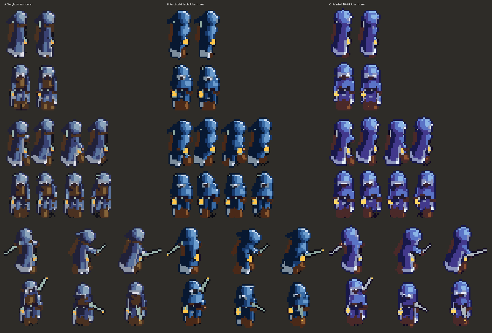
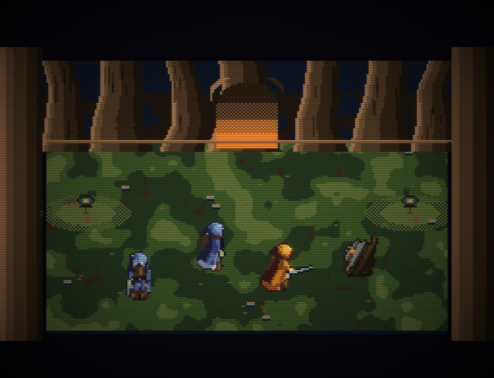
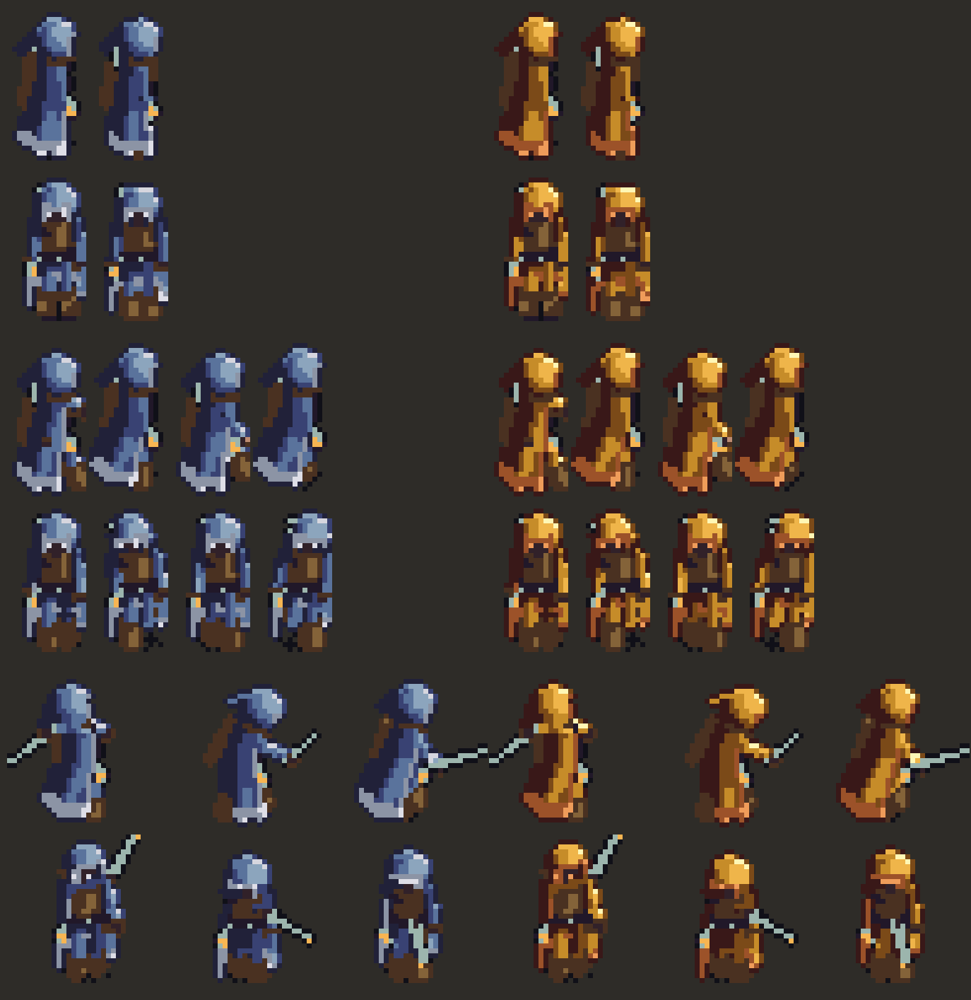

# 15 — The art-direction spike (2026-11-17)

> **Owner direction:** the 16×16 and 16×32 spikes (14) met their technical bar
> but not the vision. "We are not trying to make better low-poly characters. We
> are trying to create living storybook illustrations that happen to be animated
> using a 3D-assisted pipeline." Produce three distinct treatments of the same
> wanderer, show each in a representative room, and let the owner choose before
> any animation system is built.
>
> **Status: for the owner's sign-off. Nothing here is committed to as the
> character system.** Run it: `art/dungeons/style/build_style.sh` (20 s, three
> treatments); tests: `tests/test_dungeons_style.py` (18, no Blender).

## 1. Why 14's sprites missed, in the order I found it

| what 14 did | the look it produced | what replaced it |
|---|---|---|
| smooth-shaded primitives (capsules, boxes, spheres) | clean plastic | a pleated cloak with a ragged hem, a belt, a strap, a satchel, a back-slung sword, a lantern on a hook; the face is a dark recess with **no eyes modelled** |
| an area-average downsample | shading as noise, a flat one-colour outline | a painter's stage (`paint.py`, §3) |
| big skin-coloured face with eyes | the cartoon face the brief rules out | a dark hood slit; two 1-px glints are **stamped by hand** |
| no weapon | nothing to read for combat | the iron sword (05 §1.1: reach 18, arc 90): hilt over the right shoulder when sheathed, in hand for the attack |

## 2. The three treatments

All three share one rig, one set of motions (`style/actions.toml`) and one
painter. They differ in the **model parameters, the paint rules, the palette and
the light**, which is the point: a treatment is a data file
(`art/dungeons/style/styles/*.toml`).

| | **A — Storybook Wanderer** | **B — Practical-Effects Adventurer** | **C — Painted 16-Bit Adventurer** |
|---|---|---|---|
| intent | restrained, atmospheric, human-like | slightly exaggerated, tactile, eccentric | traditional SNES craft, storybook colouring |
| form | about 4 heads; long cloak; a hood tail that drapes down the back | top-heavy: a capelet, a crooked drooping hood tail, a hunched head, a ragged narrow hem; oversized satchel and lantern | about 3.5 heads; a big rounded hood; simple chunky shapes |
| light | low, from the left | very low, strong side light, deep shadow | classic top-left |
| colour | dusty, desaturated, pale-mist highlights; P2 honey-gold | deep dusk blue, crunchy contrast, rim 2 | violet shadows, cyan lights, saturated |
| painter | smooth 0.65, 3 cluster passes | smooth 0.45, 2 passes, rim 2 (texture kept) | smooth 0.85, 4 passes (big flat shapes) |
| face | dark slit, two cool glints | a tight slit with one big glint: one-eyed, strange | glints merge with the hood rim into a visor bar |
| model px / frame | 319 | 338 | 334 |

Every frame is the same size: **idle and walk 16×32, attack 32×32** (the sword
needs the width). Facings shown: **right** (side) and **down** (front); `up` and
`left` are not drawn here (left is the right frame's HFLIP, 11 §2).

## 3. The painter (`art/dungeons/style/paint.py`)

It keeps 14's data frames (R sun, G material id, B ambient occlusion; no colour
matching anywhere) and replaces the pixel decisions:

1. **Material** by weighted vote; shade smoothed *within* a material, then
   quantised on the style's own ramp thresholds, so bands are shapes.
2. **Clusters:** a stray material pixel or an orphan step folds into the band
   around it, and a 1-px line of one step between two pixels of another is
   removed. Single-pixel noise cannot survive.
3. **Contact:** where the cloak passes over the tunic, the tunic gets its darkest
   step along the seam, a painted shadow line.
4. **Rim:** the lit silhouette edge steps one up the ramp.
5. **Selout:** the outline is the darkest step of the material it encloses,
   **never flat black**, and one step softer on the lit side.
6. **Shadow:** a small ground shadow with a dithered edge, not a solid disc.
7. **Stamps:** hand-authored pixel clusters (the face glints, the lantern's
   bloom, the blade's edge light) placed at the projected 3D locators, so they
   follow the animation but are *drawn*.
8. **Overrides** (the hand-cleanup layer): `[override.<action>_<dir>_<n>]` pixels
   in the style file, applied last. Demonstrated on A's front idle: two boots
   with a dark gap, lit edges and dark soles
   (`out/a_storybook/cleanup_before_after.png`). **Only that one frame has been
   cleaned by hand.** The mechanism is committed and tested; the pass is not done.

Nothing is random: the same style file and frames give the same pixels.

## 4. Judged in the room

`room.py` paints a **mock** Hollow Wood room: colossal root walls with a lit top
bevel, a hollow-log doorway, a moss floor with leaf litter, two fungus braziers
and a Rootling (10 §3, §5). It uses one 15-colour BG palette (asserted). It is
scenery to judge against, not shipped art.

`out/<style>/room.png` is the native 256×224 frame, `room_x3.png` is that at 3×,
and `room_crt.png` is a CRT look-alike (8:7 pixels, scanlines, bleed, bloom).
**It is a simulation, not a measurement on a real CRT**; I cannot test on one.
`out/<style>/native_1x.png` is every frame at true 1×.

**What the room taught that the sheets did not** (each was fixed, in this order):

1. **B's teal camouflaged on the moss.** A treatment can look right on a grey
   sheet and vanish in its own biome: hue separation from the scenery is a hard
   constraint, not a taste. B went back to dusk blue.
2. **P2 amber blended with bark patches and the Rootling**, all orange-brown, so
   hero, scenery and enemy were one hue. P2 is now a brighter golden amber with
   dark umber shadows; the Rootling went to a cold dark bark with a lichen-lit
   edge, so **only its ember eye is warm**.
3. **The floor fought the figures** until it was quieted to three moss tones with
   rare bark dust (10 §2: desaturated mid-tones carry the screen).
4. **The blade was one pixel wide.** It is two now, and reads at CRT softness.

## 5. Acceptance criteria

| criterion | evidence | status |
|---|---|---|
| recognisable at native resolution on a CRT | `native_1x.png`, `room_crt.png` (simulated) | **met in simulation**; not on hardware |
| distinct from enemies and scenery | the room, after the §4 fixes: blue / amber heroes vs moss, a cold Rootling | **met for all three after the fixes**; B has the lowest value contrast against the darkest moss |
| facing and attack direction instantly | side attack: wind-up / slash / follow-through reads from the silhouette; front attack reads as a diagonal slash across the body (a pitch swing foreshortens, so it is keyed with `roll`) | **met** |
| weapon readability | a 2-px steel blade with a warm tip glint; the hilt over the shoulder identifies the sword in every facing | **met**; thin at the wind-up of the front attack |
| feels like a Lumenvale inhabitant | the lantern, the cloak, the dark hood; set in the room | **partly** (§7) |
| fits SNES constraints | indexed 4bpp, index 0 transparent, 16 colours, every colour BGR555-exact, P1/P2 differ in 1–7 only; tested | **met** |
| hard 60 fps | static art, and the console path is unchanged from 14 §6.2 (two OBJs a figure, rebuilt each frame) | **not measured**: no ROM was built for these frames and no cycle count taken; nothing here suggests a new cost, but that is an argument, not a measurement |
| minimal face detail; no cartoon eyes; no plastic, no faceted geometry | a dark slit with 1-px glints; smooth shading is banded, folds are real, outlines are selective | **met for A and B**; C's visor bar is the closest to a mask |

## 6. P1 and P2 for the preferred treatment

Same indices, two palettes (`palettes.json`): P1 dusk blue with a silver trim,
P2 honey-gold with a copper trim. The front-edge trim down each side of the open
cloak is what carries the player identity in a front view. Both heroes are in
`room.png`; `anim_p1.gif` / `anim_p2.gif` play idle, walk and attack at game
timing.

## 7. Recommendation, and what is still missing

**A, with three things taken from B:** the draped-and-crooked hood tail for
character, the lower side light for theatre, and the bigger lantern as the one
warm note on the figure. A best matches "restrained, atmospheric, human-like",
its dusty palette is the closest to "dusty and luminous", and its face is the
right amount of nothing. **I would not take C**: it is the cleanest to produce
and the most generic; its saturated palette is the furthest from the film's
dust. **B is the most alive and the riskiest**: its hunch reads less
"human-like" than the brief asks, and a one-eyed hood may be too strange.

**None of the three reaches the north star yet.** What is still missing:

- **Painterly surface.** The cloak is banded shading, not worn fabric: no
  stitching, patches, stains or fraying beyond the geometry. The override layer
  is the place for it, and only one frame has had a hand pass.
- **The `up` facing**, a walk with more than 4 frames, and the swing as its own
  **weapon layer**. The attack renders body and sword together; 05 specifies the
  sword as a separate swing sprite.
- **Palettes are inline in the style files**, not yet `palettes.json` from a
  generator (11 §5 stage 1).
- **The room, the Rootling and the CRT are mocks.**

## 8. Budget consequences (to carry into 02 and 05)

- A 16×32 figure is two 16×16 OBJs (14 §6.2). A 32×32 attack frame is one large
  OBJ in OBSEL size mode 3 (16 / 32), or four 16×16s in mode 0. **That choice
  changes every enemy's OBJ size set: decide it with 02.**
- The 18 frames drawn here use about 157 non-empty 8×8 tiles (about 5 KB). Add
  the `up` facing and the set is roughly 230 tiles, about 7 KB, to stream.
- **A 16×32 hero beside a 16×16 grunt (05) is out of scale.** The room shows it:
  the Rootling mock is drawn 20×24. 05's enemy sizes need a decision.
- The hero is about 1.6 metatiles tall. 11 §2 should say so on purpose.

## 9. Decisions for the owner

1. **Which treatment** (A, A with B's traits, B, or C).
2. **Hero size:** 16×32, with the attack on a 32×32.
3. **How much hand cleanup is the art budget:** every frame (about 70 frames), key
   frames only, or only where the painter fails.
4. **Whether a ROM proof comes next:** `game/dgn_hero` showing the chosen
   treatment on the console, with the tests that read its output.
