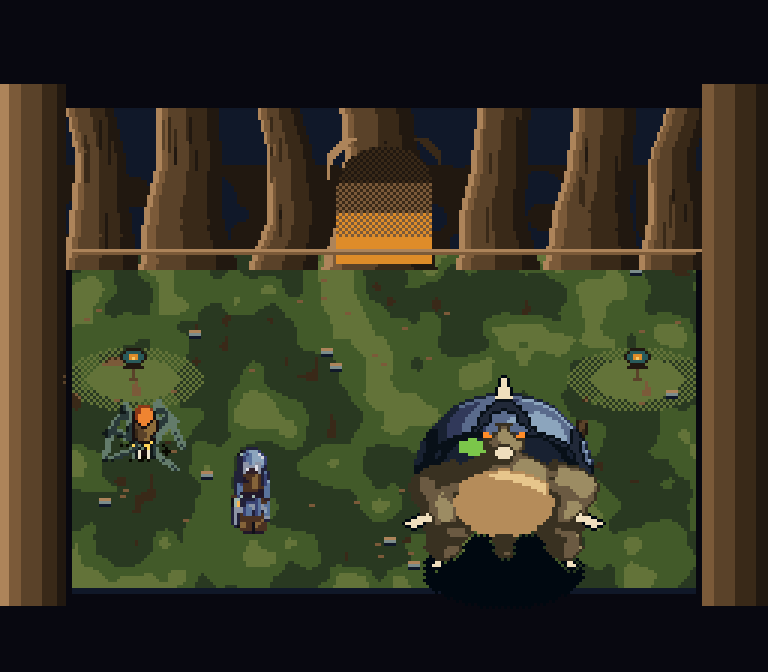

# 16 — The creature pipeline (2026-11-17)

> **The owner's challenge:** the hero sprites look "only marginally OK for the hardware", and the
> pipeline may not scale. *What if we wanted a 32×32 spider enemy? A giant tortoise boss that moves,
> rises onto two feet and stomps? What would the pipeline need, and what is the best one that can be
> built on the hardware available, and made available to Fable?*
>
> **Short answer: a creature must be a data file, not a hand-built model.** That is built, and proven
> on exactly those two cases. It does not by itself raise the *quality ceiling*; §4 says what does.
> Run it: `art/dungeons/creatures/build_creature.sh spider` (8 s), `... tortoise --dirs down`.
> Manual for the agent: `.claude/skills/creature-art.md`. Tests: `tests/test_dungeons_creatures.py` (28).

## 1. What was wrong with scaling the hero pipeline

`render_style.py` is one character: a Python function with its coordinates written in. A spider
would be a second such function, a tortoise a third, each keyed by hand, each with its own bugs. The
cost per creature would be days, and the *eighth* creature would cost as much as the first.

| a creature needs | the hero pipeline | the creature kit |
|---|---|---|
| a body | Python, coordinates inline | `[[part]]` entries: ellipsoid, limb, box, cone, tube, `dome` |
| limbs that plant and move | FK, keyed by eye | **IK leg sets**: hips and home feet in, bones, targets, poles and meshes out |
| a way of moving | per-frame keys | **gait generators** (`tetrapod`, `walk4`, `trot4`, `biped`) and **pose actions** with planted feet |
| its colours and ramps | the hero's role table | a **family** in `roles.toml`, a palette in the spec |
| surface detail | shading | detail as a **role map** (a tortoise's hex scutes are two roles, plates and seams) |
| to know it fits | nothing | **budget model**: tiles, OAM, slivers, and a BG pose's streaming cost |
| a way to review it | a hero-only sheet | family-agnostic sheet, GIF at game timing, in-room scene, CRT preview |

## 2. The two cases the owner named

### A 32×32 spider (`specs/spider.toml`, about 150 lines of data)
Eight IK legs on an alternating-tetrapod gait, a bark carapace, an ember-sigil abdomen, ember eyes;
actions: idle, skitter (4 frames), bite (rear up, strike, recover).

- **Console cost, measured from the painted pixels:** 9 frames, **one 32×32 OBJ each** (1 OAM entry,
  4 slivers on a line), at most 15 tiles a frame, **125 unique tiles (4,000 B) for all nine**.
- **What it taught:** a lunge needs headroom (the bite has its own anchor), and thin limbs must be
  drawn as clean lines: a painter rule (`no_outline`) added for every creature.

### A giant tortoise boss that rises and stomps (`specs/tortoise.toml`)
A scute-patterned dome shell, four thick IK legs, a bending neck, spikes and moss. Actions: idle, a
four-legged plod (the lateral-sequence walk), **rise** (6 poses) and **stomp** (5 poses).

- **How it rises onto two feet:** the body bone pivots at the *pelvis*; the pose action pitches it
  nose-up while the hind feet carry `plant` (fixed in the world) and the forelegs lift. The IK keeps
  the planted feet from sliding while the body tips over them. About 20 lines of data.
- **The stomp:** lean back (anticipation), slam the forelegs to the ground with the body dipping
  (impact squash), settle, recover. The hind feet never move.
- **Console cost** (a boss is a BG2 background, 02 §1): 17 poses at 112×112; **at most 70 unique tiles
  a pose against the 320-tile buffer; the worst pose change streams 62 tiles = 1,984 B, inside ONE
  VBlank (5,952 B measured); 756 unique tiles (24 KB) of ROM for the whole set.** A boss this size is
  comfortable, and the same model would refuse a pose that is not.
- **What it taught:** a boss's palette must be distinct from its biome. The first (moss green) vanished
  on the moss floor; a slate-blue shell fixed it as a data edit, with no re-render.

## 3. Honest quality of what was made

Both are **first passes, a few hours each**. The spider reads at once but its face is crude and its
legs are flat grey lines. The tortoise's shell reads as two large plates, not a fine hex pattern, and
its face is a few pixels. **Neither is hand-made-quality art.** They prove the *pipeline* (a new
creature in a data file, moving correctly, within budget); the art is the next, separate effort.

## 4. The quality ceiling, and what raises it

The owner's first worry is right. A pipeline of "render a 3D model, downsample it" is capped near
*competent*: the best SNES sprites are hand-placed pixels, where every cluster is a decision about
silhouette, a highlight shaped to the form, a deliberate exaggeration. A procedural stage makes local
decisions; a pixel artist makes global ones. Scale does not fix that; it multiplies it.

**The best pipeline the hardware allows is a hybrid with the agent as the pixel artist**:

| layer | who does it | status |
|---|---|---|
| body, rig, gait, pose, timing, palette | **data** (spec) | built, proven on 3 figures |
| shading bands, outlines, rim, contact, clusters | **the painter** (rules) | built |
| detail that follows the animation (eyes, glints, a lantern) | **stamps** at 3D locators | built |
| what the rules get wrong | **the agent, pixel by pixel**, in a committed override layer | mechanism built; **one frame done** |
| "is it good?" | **the agent LOOKING** at sheets, GIFs, the room, a CRT preview | built |
| "does it fit?" | **budget tools** | built (OBJ and BG) |

Fable can see images, so the review loop is real: build, look, change the data, repeat. What is *not*
built, in order of value:

1. **Cleanup that survives re-renders and spreads across frames** (edit propagation along the
   locators, onion-skin diff, a stale-override warning). Without it, hand cleanup is the cost that does
   not scale. *Largest single gap.*
2. **Layered renders** (a boss body on BG2 plus limbs as OBJs; a weapon as its own swing layer).
3. **Better source forms**: subdivision, displacement and metaball bodies instead of primitives;
   decal/texture roles for painted detail (scutes, fur, stitching) following the surface.
4. **A motion library**: more gaits (fly, slither, hop), impact and squash timing templates, and
   `[fx]` hooks (screen shake, palette flash) the engine converter reads.
5. **The converter and a ROM proof** (`obj_stream`, BG boss streaming): nothing here is measured
   on a console yet, only counted against the documented budgets.

## 5. What the hardware allows (checked, not assumed)

- **Blender sees the RTX 2070** (CUDA and OptiX) under WSL2, with 8 GB. The renders do not need it:
  data frames are 2 samples with no bounces, a creature in 4-9 s on the CPU.
- **Generated 3D (TRELLIS.2, 24 GB required) cannot run here**, and would not help: no role map, no
  rig, no determinism, and a million-triangle mesh collapses to ~300 pixels anyway.
- **Local image generation (SDXL-class) should fit in 8 GB** for *concept references only*: moodboards,
  turnarounds, proportion studies that feed the spec. **Not installed and not tried**; it is a ~7 GB
  download and needs the owner's go-ahead. It would never ship art.
- **UniRig (8 GB)** would auto-rig a generated mesh; unnecessary when rigs come from the spec.

## 6. Findings that will recur

- **Judge a palette in its biome.** The hero (15 §4) and the tortoise both vanished against moss.
- **A boss is a tile budget, not a sprite size:** count unique tiles per pose and the tiles each pose
  change must stream. Budget tools, not intuition.
- **Foot rows differ by facing**; publish the root row (14 §6.2).
- **Thin parts want no outline ring.**
- **A forward swing foreshortens:** key sideways motion with `roll`.

## 7. Decisions for the owner

1. **Adopt this as the production approach** (spec-driven creatures, painter, agent cleanup), or choose
   hand-pixelling first with 3D as reference only. I recommend the hybrid; hand-pixelling does not scale
   to a bestiary and a boss's pose set.
2. **What to build next:** (a) the cleanup tooling (§4.1), (b) layered renders, or (c) the converter
   and a ROM proof. I recommend (a) then (c): quality first, then measure it on the console.
3. **Enemy and boss size classes** for 02 / 05: a 16×32 hero beside a 16×16 grunt is out of scale; a
   32×32 spider and a 112×112 boss both fit the budgets above.
4. **Whether to install a local image generator** for concept references.
