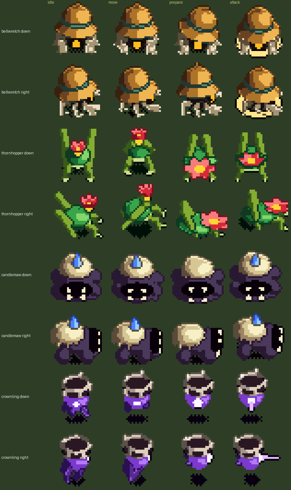
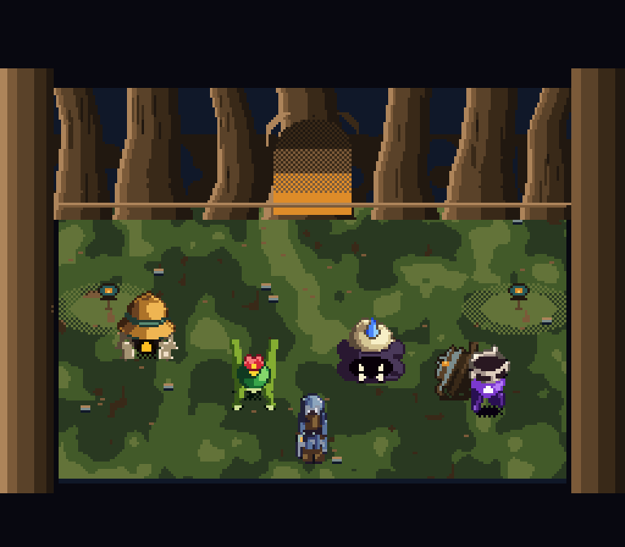

# 17 — The four briefed enemies (2026-11-17)

> **The owner's brief** (`docs/dungeons/refs/enemy_art_guidance.md`, with the owner's reference sheet
> `refs/enemy_sheet_reference.png`): four 32×32 3/4 top-down enemies, each with an idle, a move, a
> telegraphed *prepare* pose and an *attack*, readable from the silhouette alone, with movement that
> shows personality: Bellwretch (heavy), Thornhopper (spring-loaded), Candlemaw (lumbering), Crownling
> (weightless). **Build them with the creature pipeline (16) and animate them.**
>
> **Reference, not an asset** (13 §6): the sheet is guidance only. It is stored under `refs/` with a
> README saying so, and was never traced or converted. Every creature below is built from a spec.
> Run: `art/dungeons/creatures/build_creature.sh bellwretch` (also `thornhopper`, `candlemaw`,
> `crownling`); the board: `python3 art/dungeons/creatures/bestiary.py`.

## 1. What was built

| | Bellwretch | Thornhopper | Candlemaw | Crownling |
|---|---|---|---|---|
| anatomy (from the brief) | bronze bell over a crab body, six pale legs, two pincers, one amber eye | emerald frog, folded mantis hind legs, crimson flower-bud head, one yellow eye | dark quadruped under dripping wax, blue flame, huge mouth, four teeth | ivory crown with five uneven points over one violet eye, four tendrils |
| move | tripod **scuttle**; the bell rocks with each step | squash-and-stretch **hop** with the hind legs thrown back | **waddle** (a walk gait), the wax sways, the flame flickers on its own | **drift**: hover-bob, tendrils trail in a travelling wave |
| prepare (the telegraph) | every leg plants; the bell rocks harder each frame | crouch deeper, the legs compress, the petals **open** | the **flame goes out**; the jaw starts to open | the tendrils **contract**; the pupil swells |
| attack | the bell **slams**; a ring of sound expands | **leap**; hangs over the player with the bloom wide, bounces on landing | gape, **lunge**, **snap** | the beam grows out of the pupil along the facing |
| frames per facing | 14 | 13 | 14 | 14 |
| spec | 235 lines | 214 lines | 250 lines | 614 lines (generated: 12 tendril bones) |
| bones | 16 | 12 | 13 | 17 |

**Console cost, measured from the painted pixels, both facings:** every creature is **one 32×32 OBJ**
(1 OAM entry, 4 slivers on a line), at most 15 tiles a frame. Unique tiles: Bellwretch 322 (10.3 KB),
Thornhopper 278 (8.9 KB), Candlemaw 317 (10.1 KB), Crownling 250 (8.0 KB): **about 36.5 KB for all four**.
A third facing (`up`) is not drawn; left is the right frame's HFLIP.

## 2. How the brief's animation cues were met

- **Bellwretch's bell rocks with each step** is a `bell` bone keyed in time with the tripod gait; the
  slam and the shockwave are a pose action plus a **ring part whose scale is animated** from a collapsed
  0.01 (so it is invisible in every other action).
- **Thornhopper's legs compress dramatically** is `shape.stretch` below 1 (squash) before each jump and
  above 1 (stretch) in the air, on a dedicated bone that carries the body meshes but not the IK legs.
  **The petals open** is `flower.stretch` going from a tall bud (1.5) to a flat bloom (0.5).
- **Candlemaw's flame extinguishes** is the flame bone's `scale` and `stretch` going to nearly zero;
  **the mouth opening** is a jaw bone pitched 34° then 56°; **the flame flickers independently** is a
  different loop length and phase from the waddle.
- **Crownling's tendrils undulate** uses the new `wave` generator (a travelling wave, each bone lagging
  the one before it); **retracts** is the tendril root bones' scale and pitch; **the beam** is a cone that
  grows out of the pupil.
- **Every attack has a distinct anticipation, readable without particles**: the silhouette changes in
  the prepare frames (a bell leaning over, a flower opened flat, a flame gone, tendrils pulled in).

## 3. What the pipeline had to learn (all generic, none creature-specific)

`lathe` (a surface of revolution: the bell), `ring` (a flat torus), `spikes` (crown points, wax drips),
`petals`; `scale` and `stretch` pose channels (stretch is volume-preserving); `[action.*.wave]`;
`[default.keys]` (held in every action unless it keys the channel); `knee_vec` (a folded mantis knee);
`rot` on ellipsoids. The pure parts are in `sugar.py` and tested (49 tests, no Blender).

## 4. An honest assessment of each

- **Bellwretch: strong.** Bell, eye and legs read at once; the slam and the ring read. Weak: the bell
  is somewhat pointed (a witch's-hat look in one tilt), and the pale legs are mush at this size.
- **Thornhopper: the best.** The tall folded legs and the red bloom are an unmistakable silhouette and
  the hop's squash-and-stretch carries the "spring-loaded" feel. Weak: its green sits close to the moss
  floor (the red flower rescues it); a lighter emerald would separate better.
- **Candlemaw: good.** Wax, flame and a mouth that reads in the front view. Weak: in the side view the
  mouth is a black slab, and the "enormous mouth" is only clear from the front.
- **Crownling: the weakest.** It reads as a crown-ring over a violet eye, but the five points are timid
  and the eye is not the focal point it is on the reference. It needs the cleanup pass most.
- **None has had a hand-cleanup pass** (14, 15 §3); these are painter output.

## 5. Findings

1. **Closed shapes lose a crown.** A closed dome hid the gaps between the points and read as a white cap;
   an open band with a shallow hollow reads as a crown. Detail that is *negative space* needs the
   geometry to leave the space.
2. **A scale and a stretch on one bone must multiply.** My first version let the second overwrite the
   first, so an "extinguished" flame stretched sideways into a blue disc.
3. **One anchor serves both facings.** A lunge toward the camera needs headroom at the bottom of the
   box, a lunge to the side needs it at the front, and a per-action anchor is shared by both. Each of
   the four needed it tuned (refuse-never-crop named the pixel every time).
4. **Silhouette first worked.** Designing each creature as one clear mass plus one accent (a bell + an
   amber eye, a flower + legs, wax + a flame, a crown + an eye) made them separable before any
   shading; the painter only had to not spoil it.

## 6. Decisions for the owner

1. Which creature should get the first **hand-cleanup pass** (I suggest Crownling, then Bellwretch).
2. Whether the **`up` facing** is needed for these (walking away reads differently).
3. Whether **Thornhopper's green** should move away from the moss, or the Hollow Wood floor should.
4. The **OBSEL pair**: these are all 32×32, the hero is 16×32 (two 16×16 OBJs): a 16/32 pair fits both,
   but it is the decision 02 §3 and 05 still owe.
