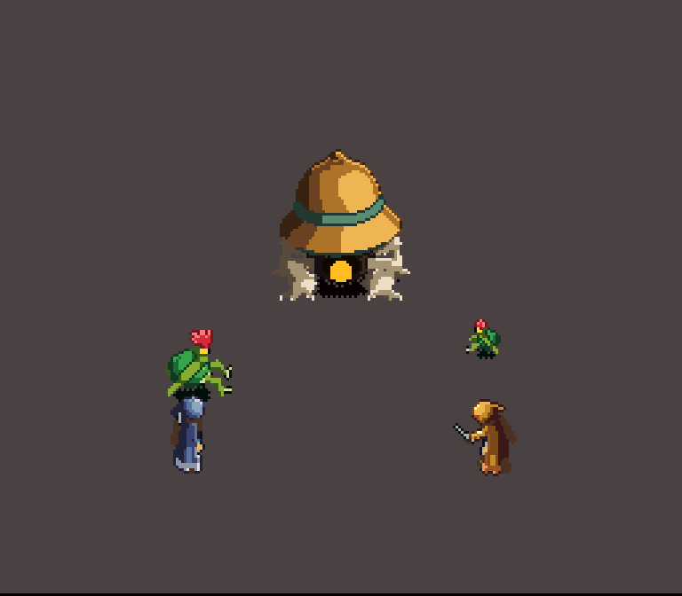

# 18 — The boss-battle scene on the console (2026-11-18)

> **The owner's question:** treat 64×64 conceptually as a boss battle: *this* enemy, both player sprites
> (with attack animations), and at most two other simplified enemies at 16×16 or 32×32. **Spike the scene,
> loaded, and see what breaks.**
>
> **Short answer: it runs, and the first thing that runs out is VBlank, not OAM, VRAM or sprite limits.**
> The worst frame (the boss and both players change frame together) finishes on scanline 255 of a VBlank
> that ends at 261; a second 64×64 stream in the same frame does not fit, and **when it does not fit the
> failure is silent and permanent** (§3). Run it: `make dgn_boss`; tests: `tests/test_dgn_boss.py` (11,
> ~22 s); footage: `docs/dungeons/img/dgn_boss_arena.gif` (a full boss cycle at game timing).

## 1. What was built

`game/dgn_boss` (a rail like `dgn_hero`, registered at all ten sites): one scene, OBJ only, over the
floor-coloured backdrop. **No BG floor, no HUD, no input, no AI**: five scripted timelines (boss, P1, P2,
two enemies) so the numbers are a function of the ROM alone.

| actor | size | how it reaches the screen | art |
|---|---|---|---|
| **boss** | 64×64 | **streamed**: one VRAM slot (8×8 tiles), 8 DMAs of 256 B; drawn as **four 32×32 OBJs** | Bellwretch at 2× pixel density (`bellwretch64`), 28 frames (14 a facing) |
| **P1, P2** | 16×32 idle/walk, **32×32 attack** | **streamed**, a 32×32 slot each, 4 DMAs of 128 B; two stacked 16×16 OBJs, or ONE 32×32 for the attack (second slot parked) | treatment A, 9 frames (idle 2, walk 4, attack 3); P2 is the HFLIP of P1 in palette 1 |
| enemy A | 32×32 | **resident** (OBJ name table 1) | Thornhopper, 4 hop frames, ping-pongs and flips |
| enemy B | **16×16** | resident | **Thornling**, a Thornhopper shrunk to 16×16 by data (`thornling.toml`): 4 hop frames |

- **OBSEL size mode 3** (small 16×16 / large 32×32), the pair 02 §3 chose. OBJ CHR is both name tables,
  512 tiles contiguous (8,192 words); 192 tiles are used.
- **Every hold is quantised up to a multiple of 6 game frames** (`gen_dgn_boss_assets.py`), so the actors'
  frame changes coincide as often as the timelines allow. A budget measurement should be the worst case.
- 12 OAM slots, 63 of 256 DP bytes, 65,152 B of ROM, 4 of 8 OBJ palettes.

## 2. What it measured

| | measured | where |
|---|---|---|
| **VBlank, worst frame** | the NMI hook ends on **scanline 255** (VBlank is 225–261): **30 of 37 lines, 81 %** | the V counter latched at the end of the hook, read per frame |
| a frame that streams 0 / 512 / 1,024 / 2,048 / 2,560 / 3,072 B | ends on 229 / 234 / 239 / 245 / 250 / 255 | strictly monotonic: the counter is measuring the DMA |
| the allocator's charge | 3,616 B + 2,048 B arm = **5,664 of 5,952** (17 transfers) | `allocation_report.txt`: 288 B of declared headroom |
| per-transfer overhead, measured | **about 680 master cycles ≈ 85 B-equivalents** | the allocator charges 128: its model is conservative |
| sprites / slivers on the worst line | **3 sprites, 12 slivers** (the theoretical worst is 22 of 34) | read from OAM every frame |
| STAT77 (time over / range over) | **never raised** in 700 frames | the PPU's own flags, latched at the end of every NMI hook |
| streamed slots vs the committed strips | **every one of the 28 boss frames and 9 player frames intact**, 0 tears | VRAM decoded and compared with the PNG pixels, independent of the converter |
| the picture vs the committed frames | five actors, eight frames incl. attacks, pixel-exact on every uncovered pixel | screenshots |
| OAM entries for the 64×64 | **4** (not 1) | `budget.py` said 1 for `obj64`: fixed |

**Correction to the previous estimate.** I said a 64×64 boss with 14 frames a facing costs about 31 KB
of ROM. That counted *unique tiles*. A streamed slot is a **whole 2,048 B image per frame** (no dedup, no
skipped blank tiles, because each tile row is one DMA), so the boss is **57,344 B**, and a LoROM bank holds
only 16 such frames, so it is two claims. Dropping blank tile rows would claw back perhaps a third; not built.

## 3. What broke, in order of importance

1. **VBlank is the binding resource, and nothing in the build says so until it is nearly gone.** The
   composition allocated cleanly with 288 B declared headroom, and the real margin is about 6 scanlines (~8 k master cycles). The
   spike does not have a HUD, a text queue or a swing sprite. A HUD queue of ~300 B plus its arm cost
   already exceeds the pin on the worst frame in the allocator's model; the measured margin is larger
   than the model's, but not by much.
2. **The failure is silent and permanent.** The planted fault (`make dgn_boss_overload`: the boss streamed
   twice a frame) shows what an overrun looks like: the boss alone just fits (ends on 261), and the first
   frame with the boss and one player ends on scanline **4 of the next frame**. VRAM writes that land in
   the picture are dropped, but `HAVE` says the frame was streamed, so **the slot stays corrupt until it
   changes again**: 78 of 700 frames overran, 152 tear detections. *A change detector that trusts its own
   bookkeeping cannot see a dropped write.* The streamer needs a deadline guard (do not start a transfer the
   rest of VBlank cannot finish; leave `HAVE` stale so it retries) and the OAM must show the frame VRAM
   actually holds. Neither is built.
3. **Two 64×64 streams do not fit in one frame** (2 × 2,048 B at ~16 lines each, with the players, is over
   37 lines). Two 64×64 actors are possible only if a scheduler guarantees their changes never coincide with
   each other or with the players'. That is a design constraint, not a tuning.
4. **A 64×64 is four OAM entries under the 16/32 pair, and that works** (measured; the sliver cost is the
   same 8 a line). Moving to the 32/64 pair would give one entry and lose the 16×16 sprites.
5. **Doc 02's sprite ledger is wrong for the pair it chose.** §3 counts shots, drops, FX and markers as
   "8×8 small, 1 sliver each", but size mode 3 has no 8×8: every one is a 16×16 OBJ (2 slivers, four times
   the CHR). 16 shots on one line are 32 slivers, not 16. The spike does not exercise it; the ledger needs
   redoing before M5 measures it.
6. **ROM:** see the correction above. A 30-frame-a-facing boss is a quarter of the free ROM.
7. **Tooling that earned its keep:** the channel lint refused a literal `#STREAM_BIT` (a DMA mask must name
   the declared channel), and the register lint refused the `$4201` write until it was owned or
   explicitly excused (it is: the V-counter latch needs WRIO bit 7). Both are on the page, not the tree.
8. **A harness trap that cost me an hour, now documented in the test:** `Machine.screenshot()` spends one
   emulated frame and photographs *that* frame, which is drawn from the state the last NMI committed. Read
   the state **before** the call. Read after it, an enemy moving 1 px a frame sits 1 px off its OAM x and
   every actor that changed frame in that NMI is the wrong frame.

## 4. What it did NOT test

No BG floor (02 §1: resident, so no streaming cost, but it competes for VRAM and the CPU), no HUD or text
queue, no input, no collision, no AI, no swing sprites as their own streamed slots (02 §1.2 wants two more),
no `up` facing, no audio, no region (PAL's VBlank is longer, so it only helps), no real hardware, and the
CPU frame cost of the main thread was not measured (it is tiny here; it will not be in the game). Everything
is the Mesen2 core's cycle accuracy, not a console's.

## 5. Recommendations

1. **Keep the boss on BG2** (02 §1) unless it must move among the other enemies. A BG boss costs no OAM, no
   slivers and a measured 62-tile worst transition (16 §2); the OBJ boss costs the whole VBlank.
2. If a 64×64 OBJ actor is wanted (a mid-boss, an elite): **one at a time**, streamed, with the deadline
   guard of §3.2 and the OAM built from `HAVE`, not `WANT`.
3. **Build `obj_stream` properly** (02 §1.2) from this: a per-slot request queue, a VBlank scheduler with a
   byte budget and priorities (players first, boss next), and the deadline guard. This spike is the
   hand-rolled first slice. **Doc 19 measured the better shape: a scripted boss as a pre-compiled score with
   back-buffer prefetch (worst VBlank line 235 against 260).**
4. Re-do the **sliver ledger** for size mode 3 (§3.5) before M5.
5. Decide whether the **boss frame format** drops blank tile rows (≈ a third off 57 KB).

## 6. Decisions for the owner

1. **BG2 boss or OBJ boss** for the final fights (recommendation: BG2; OBJ only for a mid-boss).
2. Whether to build **the scheduler and deadline guard** now, or leave them to M3 with `obj_stream`.
3. Whether the **small-sprite problem** (§3.5) should move the OBSEL pair (8/32 would give shots their 8×8
   and keep 32×32, but lose the 16×16 hero halves) or the ledger should simply be redone.
