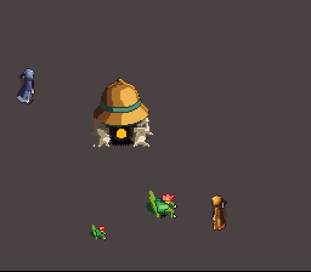
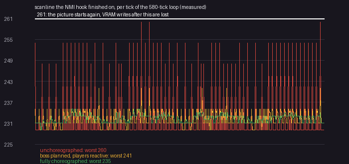

# 19 — The choreographed boss fight (2026-11-18)

> **The owner's question:** can a complicated, many-frame boss be *rolled through a pre-programmed sequence*, and
> can that sequence be used to **reduce the VBlank load in an intelligently choreographed way**? Script a scene:
> the 64×64 boss moves about the screen through a series of attack animations; one player follows it and attacks
> from several angles, backing away from each attack; the two small enemies fight the other player.
>
> **Short answer: yes, and by a lot.** The same score, streamed two ways, ends its worst VBlank on scanline
> **260** of 261 when each frame is loaded the moment it changes, and on **235** when the director prefetches it
> into a back buffer ahead of time: **10** of the 37 VBlank lines instead of 35. Run it: `make dgn_fight`
> (+ `dgn_fight_naive`, `dgn_fight_hybrid`, `dgn_fight_late`); tests: `tests/test_dgn_fight_score.py` (19, 1 s) and
> `tests/test_dgn_fight.py` (14, ~40 s); the chart: `tools/dgn_fight_chart.py`.

## 1. The scene

A 580-tick (9.7 s) loop, compiled offline by `tools/dgn_fight/director.py`. Every position, facing and frame of
every actor on every tick is data; the ROM plays it back.

| actor | what it does |
|---|---|
| **boss** (64×64 Bellwretch) | idle → scuttles right → **slam** (facing right) → scuttles left → **slam** (facing left: the right art, flipped) → scuttles down → **whirl** (the new second attack: the bell spins on planted feet) → scuttles back to where it began. Every attack is preceded by the prepare rock that telegraphs it. Five actions in two facings: 38 frames in ROM, 26 of them on screen in this loop. |
| **player 1** | chases the boss from behind and attacks from the **left**, then circles over the top and attacks from **above**, then round to the **right**; **backs away during every telegraph** (walking while still facing it) and is at least 81 px clear through every slam and the whirl. A long run back round closes the loop. |
| **player 2 + Thornhopper (32×32) + Thornling (16×16)** | six phases of 128 ticks, the enemies taking turns: hop up, open the bloom (the telegraph), **leap**; player 2 guards, **dodges the leap**, **counters**, and returns. The idle enemy bobs at home. |

New art for this: the boss's **whirl** (`bellwretch64.toml`, 5 frames a facing) and the enemies' prepare/attack
frames resident beside their hops (20 frames, a whole OBJ name table).

## 2. How the VBlank load comes down (the director)

The ROM is a **score player** with no game logic: each tick it copies one 51 B record (the OAM shadow) and plays
that tick's DMA rows. Everything clever happened offline, because the sequence is known:

1. **Back buffers.** The boss and each player own **two** VRAM buffers. The next frame is DMA'd into the one that
   is off screen, a tile row at a time, over the ticks the current frame is held; the swap is free (OAM names point
   at the other buffer). A frame already in the idle buffer (an idle that toggles A/B/A/B) needs nothing at all.
2. **Water-filling.** Each row may land on any tick of its window (released when the buffer left the screen, due
   when it must be shown). The director puts it on the least-loaded tick, then relaxes. The peak is the smallest
   the windows allow, not whatever happened to coincide.
3. **Movement is free.** Scuttling across the arena, circling, hopping and leaping change OAM x/y only.
4. **The entry state is simulated, not assumed** (§4.2): the loop's first tick starts from exactly what a full
   iteration of the stream leaves behind.

The ROM-side contract is small and checkable: every command is `(VRAM offset, source offset, blob id)`; a row is
one DMA; the allocator is told the choreographed worst tick (512 B, 3 transfers) and charges it.

## 3. What it measured

Same score, three compilations (`gen_dgn_fight_assets.py --mode`). The V counter is latched by the ROM at the end
of every NMI hook and read per frame.

| | worst tick | transfers | **hook ends on** | VBlank lines used | busy ticks | bytes a loop |
|---|---|---|---|---|---|---|
| **unchoreographed**: every row on the tick its frame changes | 3,072 B | 16 | **260** | 35 of 37 | 144 | 194,560 |
| **hybrid**: the boss planned, the players reactive | 1,024 B | 8 | **241** | 16 of 37 | 530 | 194,560 |
| **fully choreographed** | **512 B** | **3** | **235** | **10 of 37** | 578 | 189,440 |

- **The work is the same; the shape changed.** 190 KB moves through VBlank either way. The unchoreographed stream
  does it as 144 spikes (the worst nearly fills VBlank); the choreographed one as a steady drip of 256–512 B a tick.
- **The hybrid is the honest number for a game.** A player's frame follows human input and cannot be prefetched.
  Only the boss (and scripted enemies) can. Plan the boss, leave the players reactive: **241**, a quarter of the
  way back from the worst case. An upper bound with nothing known about the players is the boss's 512 B plus two
  players changing frame together (1,024 B), about 1,536 B in 10 transfers: roughly 247 by interpolation of the
  measured points (an estimate, not a measurement).
- Sprite limits: **3 sprites and 12 slivers** on the worst line; STAT77 never raised. The picture is the committed
  frames at the OAM positions (six photographed moments, including both attacks, the whirl, an enemy's leap and the
  flipped boss), pixel-exact wherever nothing overlaps.
- The allocator charges the choreographed worst tick at 1,056 B + 384 arm of 5,952 (it was 3,616 + 2,048 in 18).

## 4. What broke, in order of importance

1. **My previous commit broke `make microzero`, and the landing gate said so.** `dgnb_obj.asm` carried
   `sbc #2048` (in the never-assembled overload block); the no-literals lint reads *every* feature file against
   *every* rail's address map, and 2048 is an allocated WRAM address in microzero. The fast gates and my own tests
   could not see it; `make bare-check` went red at its sanity tests (and I had reported it as "still running").
   Fixed in `4abbecd`, with the named equate and a check of the new feature files against all 45 rails' maps. A
   new feature file's immediates are now a cross-rail hazard worth a `make` target of its own.
2. **The loop's entry state was wrong, and an independent interpreter caught it.** A prefetch whose window
   straddles the wrap has its first rows in the previous iteration's *tail*, so the first iteration started
   without them and tick 0 showed a stale boss frame. The planner's frame-level start state cannot express a
   half-loaded buffer. Fixed by simulating the stream at row level until it repeats and loading exactly that.
   `test_every_displayed_frame_is_in_its_buffer_on_every_tick` plays the *emitted binaries* against an abstract
   VRAM and shares no code with the planner; it is what found this, and it fails on any scheduler that lands a
   row after its deadline (planted and proven).
3. **Every frame change flips the displayed buffer**, so an actor with an odd number of changes in a loop would
   come round to the other buffer and repeat every *two* loops. The planner adds a deliberate re-show of the same
   frame mid-hold to fix the parity. **This score does not exercise it** (all three actors have even counts); it
   is covered only by its unit test.
4. **The table-driven row player is about 25 % heavier per transfer than the hand-coded loop of 18.** The same
   3,072 B ends on 260 here and 255 there. Still a bargain, but the command stream is not free: a 6-byte command
   and an id×6 table lookup per row.
5. **Every tick has some DMA.** 578 of 580 ticks stream a little, so the per-transfer overhead is paid every
   frame. The drip is cheaper than the spikes by a wide margin, but "zero" ticks, which a budget for a HUD queue
   would like, are rare.
6. **The score is a dense flipbook** (51 B a tick, 29.6 KB for 9.7 s, one whole bank). It is right for a spike
   because it makes every position inspectable; a shipping fight wants a cue list and interpolation. And note
   what the score really is: a *specification of what the boss logic must output*. The director's lookahead
   exists only for scripted actors.
7. **Two buffers cost VRAM.** The boss takes 128 tiles, each player 32; table 0's first 12 rows are full. The
   enemies fill all of table 1. There is room, but not for a second large streamed actor.
8. **Prefetch is bounded by the shortest hold.** A frame held 3 ticks gives a 4-tick window; the whirl, slam and
   hero attack holds were kept at 6 or more so no window is tighter than a few rows a tick.
9. **No `up` art**, so player 1 is never below the boss, which shapes the choreography. Its return run is
   2.4 px/tick, the fastest it goes.

## 5. What it did NOT test

No BG floor, HUD or text queue; no input, collision or AI (the players are scripted, which is exactly what
the hybrid caveat in §3 is about); no audio; nothing on hardware (Mesen2's cycle accuracy); the NTSC timings
only; the main thread's CPU cost (a 48-byte copy a frame) was not measured.

## 6. Recommendations

1. **Make a scripted boss a score.** Patterns are data (action, facing, path, duration); the runtime is a cue
   player; a build-time director proves the per-tick load and refuses a pattern it cannot schedule. This is the
   shape `obj_stream` (02 §1.2) should take, rather than a per-frame request queue.
2. **Reserve VBlank for the reactive actors**: budget 1,024 B (two players changing together) and plan the boss
   into what is left. The hybrid is the design point, not the all-planned best case.
3. **Keep a deadline guard in the runtime anyway** (18 §3.2): the director's proof covers the scripted part; a
   reactive stream still needs to refuse a transfer the rest of VBlank cannot finish.
4. **Cue lists, not a flipbook**, for shipping, with the director emitting the same per-tick state for testing.
5. Move the cross-rail immediate check out of the heavy gate (§4.1).

## 7. Decisions for the owner

1. Adopt the **boss-as-score** pattern for scripted boss phases, with the hybrid budget (§6.1, §6.2)?
2. A **dense score** now (inspectable) and cue lists at M3, or cue lists from the start?
3. How much VBlank to **reserve for reactive actors** (1,024 B is two players; a HUD queue and swing sprites
   would add to it)?
