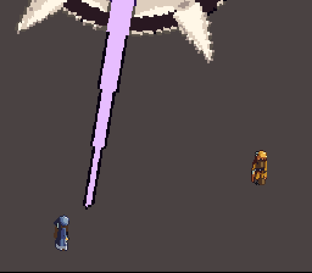
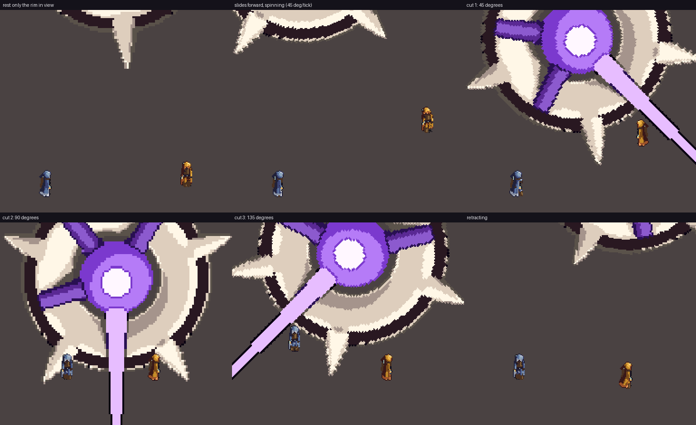

# 20 — The giant Mode 7 boss (2026-11-18)

> **The owner's request, the last test:** a boss so big it takes up the entire length of the top of the screen, with
> only a portion of the model visible at any time ("a fairly common configuration for SNES games"). Use the
> Crownling. Have it slide forward and spin as quickly as we can animate it as it slices three times at 45, 90 and
> 135 degrees while the players dodge, then retract.
>
> **Superseded as the answer to the brief by [21](21_tile_streamed_giant_boss.md).** The owner's correction: Mode 7
> spins for free, so nothing limits the spin, and it takes the room's background layer; the point of "as fast as we
> can animate it" was that the sprite/tile-streaming budget is the limiter. This doc and `dgn_giant` stay as the
> record of the Mode 7 route (right for a boss that only spins and swoops and needs no background).
>
> **Short answer: Mode 7, and it is nearly free.** The boss is *one still image* on the Mode 7 plane; the spin, the
> magnification, the slide and the pivot are the PPU's matrix registers, four words and a scroll a frame. The whole
> scene (the 256-px boss spinning at up to 45° a tick, two streamed players, the OAM) finishes its VBlank work on
> scanline **232**, of which the boss is about one line. Run it: `make dgn_giant` (+ `dgn_giant_plant`); tests:
> `tests/test_dgn_giant_score.py` (16, 1 s) and `tests/test_dgn_giant.py` (14, ~10 s).

## 1. Why Mode 7, and what it changes

Doc 02 put a boss on BG2 (a tile map moved by scroll) and docs 18 and 19 spent 2 KB of VBlank on every frame change
of a 64×64 OBJ boss. A boss this size cannot be OBJs at all (it would be dozens of them, and a rotation is not an OBJ
operation), and "spin as fast as we can animate it" is the SNES's one native rotation: the Mode 7 affine matrix.
Everything the boss does after enter is **registers**, so the streaming problem of 18 and 19 does not exist for it.

| | OBJ boss (18, 19) | **Mode 7 boss (this)** |
|---|---|---|
| data | 38 frames × 2,048 B = 76 KB, streamed | **one image, one 32,768 B plane**, uploaded once |
| a spin | a frame per angle | the matrix: **any angle, every tick, no data** |
| a slide | OAM x/y (also free) | the scroll |
| VBlank, boss only | 0.5–2 KB a frame change | **16 register writes, about one scanline** |
| OAM / slivers | 4 entries, 8 slivers a line | **0** |
| ROM for the whole scene | 154 KB (19) | **63,584 B, 2 banks** |

## 2. How the picture is made

- **The art.** `crownling_boss.toml` renders the Crownling **looking straight down** (camera depression 90°), so
  turning the image in the plane is the crown turning on its own axis: a flat ivory rosette with five uneven
  points, a violet eye, four tendrils and one long violet blade along "down". 113 px across, 128×192, **150 of
  Mode 7's 256 distinct tiles** (tile 0 is the blank; the rest of the 1024×1024 plane is tile 0).
- **The magnification.** 2.25×, so the crown spans 254 of 256 px: the whole width of the top.
- **Only part is ever in view.** The eye rests 78 px *above* the screen, so at rest only the lower rim shows (8 % of
  the crown). The fullest it is ever seen is 82 %. It is never whole.
- **The matrix.** `A = D = cos/2.25`, `B = -C = sin/2.25` (8.8), the pivot at the plane's centre, and
  `HOFS/VOFS = pivot − (where the eye is on screen)`, so the eye lands where the score says and turns about itself.
  The score carries the 8 words each tick; the main thread drops them in a 16-byte shadow and the NMI hook commits
  them (the `m7_affine` idiom: nothing touches a PPU port outside VBlank).

## 3. The sequence (290 ticks, 4.8 s)

| ticks | what happens |
|---|---|
| 0–20 | **rest**: the eye above the screen, the blade pointing up, only the rim in view |
| 20–60 | **slide and spin up**: swings to the left while spinning 3+ turns, snapping to heading 45° |
| 60–94 | **cut 1 (45°)**: the blade locked, the eye **lunges 130 px along it**, holds, withdraws |
| 94–134 | spin (3 turns) while sliding to the centre; snaps to 90° |
| 134–168 | **cut 2 (90°)**: straight down |
| 168–208 | spin to the right-hand side; snaps to 135° |
| 208–242 | **cut 3 (135°)** |
| 242–290 | **retract**: spins out and slides back up |

The eye swings to the left, centre and right for the three cuts so that each blade's line crosses the screen.
Peak spin is **45.5°/tick** (eight ticks a turn): the crown's five points repeat every 72°, so a faster spin is not
animation, it is aliasing (the points appear to stand still or turn backwards).

**The players.** Each cut has a corridor along its blade, just outside its reach. A player stands in it, and as the
spin decelerates into the lock it **sprints 32 px perpendicular** (2.7 px/tick) and is clear (≥ 28 px from the
blade's centreline) before the eye lunges; the two players take the straight-down cut together and go opposite
ways. The closest any player gets to a cutting blade while it is in reach is 32 px. They walk back at 1.4 px/tick.
The players are the same streamed back-buffer OBJs as 19 (peak 256 B a tick), with the same scheduler through a
two-actor `Layout` (the director was generalised; the existing fight's output is byte-identical).

## 4. What it measured

| | |
|---|---|
| **VBlank, the whole scene** | the NMI hook ends on **scanline 232** (VBlank is 225–261): 7 of 37 lines. Ticks with no player row end on 230, with one row 231, with two 232 |
| the boss's own cost | **about 1 line** (230 against the 229 of an OAM-only hook): the eight write-twice matrix ports |
| sprites on the worst line | **2 sprites, 4 slivers** (the boss is not a sprite) |
| STAT77 | never raised |
| the plane in VRAM | **byte-identical** to the committed 32,768 B blob |
| **the picture** | the background is **pixel-exact against the reference renderer** at eight poses (rest, the spin's peak, mid-slide, all three cuts, a withdraw, the retract) |
| tile budget | 150 of 256: room to spare for more detail or a larger crown |
| ROM | 63,584 B of 2 banks |

## 5. What broke, and what was learned

1. **The PPU's Mode 7 is not the textbook formula, and a test against the textbook formula is red on a correct
   ROM.** Per scanline it clips the scroll-minus-pivot offsets to 10 bits, **drops the low 6 bits of every
   offset × matrix product** (`& ~63`: a quarter pixel of positional noise that depends on the matrix, and is why
   a rotating plane shimmers), and numbers its lines from 1. The first reference renderer used the naive
   formula and disagreed with the machine by hundreds of pixels at every pose, even at 0°. With the real
   arithmetic it is pixel-exact; `test_the_naive_mode_7_formula_is_wrong_on_the_real_picture` pins the
   difference.
2. **My first version of the picture test did not test the poses it named.** The ROM has been ticking since boot,
   so sample *k* shows tick `BOOT + k − 1`, not tick *k*; the three "cut" shots had no blade in them and the
   comparison was still green, because it checked whatever tick was on screen. Found by LOOKING at the pose sheet.
   The test now looks the sample up, asserts the ROM is on the asked-for tick, and checks the blade is on
   screen at each cut.
3. **Mode 7 takes the whole screen's one BG layer.** BG1 is the plane, so there is no tile layer for text or a HUD
   (`bg_text` cannot compose), and the arena floor is the backdrop colour only: **CGRAM word 0 is both the plane's
   transparent index and the backdrop**, and a scene composing `backdrop` beside Mode 7 must refuse (it does). A
   textured floor needs the mode split the kit already has for `mode7_chamber` (Mode 7 above a seam, Mode 1 below);
   that is not tried here.
4. **Rotation of a magnified bitmap is jagged.** 2.25× is not an integer, so the screen shows uneven pixel sizes
   and stair-stepped diagonals on the blade; the plane's pixels are also 2.25× the players'. It reads as "a big
   thing", the usual Mode 7 look, but it is not clean.
5. **Mode 7 pays for itself in tiles, not bytes.** 256 distinct tiles is the budget; the crown used 150 because
   most of the plane is the blank. A busier or larger boss will hit the limit before anything else does.
6. **The spinning blade sweeps the whole screen**, and only the *locked* blade is treated as a hazard. During a
   spin the blade passes behind the players (BG is under OBJ). A real fight would have to decide whether the
   spin hurts, and the score would then have to keep the players out of the sweep disc.
7. **There is no `up` art for the players**, so they never face the boss, which is above them.
8. **Spin speed has no hardware limit here**: a new matrix every tick at any angle. The limit is perceptual, as in
   §3. "As quickly as we can animate it" is 45°/tick for a five-pointed crown.

## 6. What it did NOT test

No HUD or text, no textured floor (3), no Mode 7 EXTBG, no per-scanline matrix (HDMA) effects such as a tilted or
curved crown, no collision or AI (the players are scripted), no audio, nothing on hardware (Mesen2's cycle
accuracy), NTSC only. The crown is one pose: "retracting" is the slide and spin, not a change of shape, because the
plane holds one image.

## 7. Recommendations

1. **Use Mode 7 for a boss that is huge and spins or swoops**; use the OBJ score pattern of 19 for a boss that
   *animates* (a new frame, not a new angle). They compose: a Mode 7 body with OBJ limbs or a face.
2. **Try the Mode 7 / Mode 1 split** before committing: the arena floor and a HUD are what this rail lacks.
3. Keep the **reference renderer** (`tools/dgn_giant/director.py::render_m7`) as the project's Mode 7 oracle: it is
   the PPU's arithmetic, validated pixel-exact against the machine.
4. If the boss's spin is a hazard, model the sweep disc in the director and fail the build when a player is in it.

## 8. Decisions for the owner

1. Is **Mode 7 the right size-class for the final bosses** that are "too big for a sprite", with the OBJ score for
   the ones that animate?
2. Do you want the **Mode 7 / Mode 1 split** tried next (a floor and a HUD under the giant)?
3. Should the **spin itself be a hazard**, which constrains the choreography (§5.6)?
