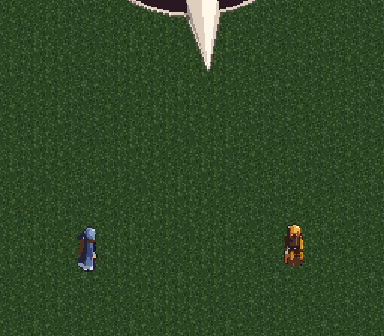
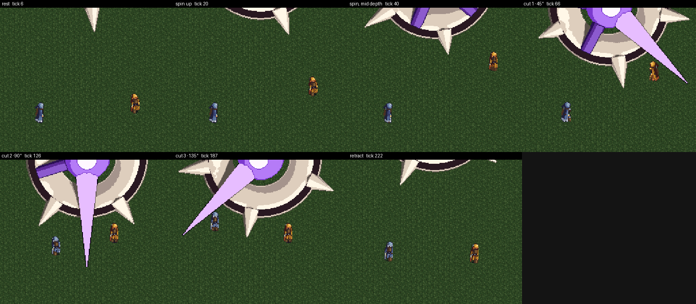

# 21 — The tile-streamed giant boss: the streaming budget as the limiter (2026-11-18)

> **The owner's correction to doc 20.** Mode 7 was "an impressive hack" that is the wrong test: it spins for free, so
> nothing limits the spin, and it takes the room's background layer. The point of "spin as fast as we can animate it"
> was that **sprite streaming (how many tiles of how many animation frames can be loaded per frame) is a solvable
> equation, and that equation is the limiter** on how fast the Crownling can rotate, extend its blade, retract and
> rotate on, *at a readable level of detail*.
>
> **Short answer.** The boss is now a set of *pictures* (the Crownling rendered every 30° looking straight down)
> streamed into two page-flipped **Mode 1 BG layers**; the room's floor stays on BG3. A spin is a sequence of picture
> swaps, so VBlank DMA, VRAM and ROM are the limits, and a director solves the schedule against them. **The spin runs
> at 30°/tick (5 turns a second) while only the rim shows, and slows to ~19°/tick as the crown slides into view and
> the pictures get bigger.** The equation below predicts both from the pictures' measured sizes; the console agrees.
> Run it: `make dgn_colossus`; tests `tests/test_dgn_tilestream_score.py` (13, 5 s) and `tests/test_dgn_colossus.py`
> (14, ~45 s).





## 0. What I decided, and what that decision cost you if it is wrong

**I read "sprite streaming" as "tile streaming into VRAM", and put the boss on BG layers, not OBJs.** The limiter you
describe (tiles loaded per frame vs animation frames) is the same equation for either, but OBJs cannot carry this
boss: it is 256 px wide, the PPU draws at most **34 eight-pixel slivers per scanline** (so one 256-px row of boss
would leave ~2 slivers for the two players and anything else on that line) and has **512 OBJ tiles** of CHR. BG layers
have neither limit, keep the rest of the screen free, and cost the same per byte to stream. If you meant OBJ literally,
say so: the equation carries over with the OBJ caps as extra constraints, and it would be a smaller boss.

## 1. The scene and what it is made of

| | |
|---|---|
| Mode | **1** (not 7). BG1 and BG2: the boss, **two page-flipped buffers**, same 16-colour palette; BG3: the room's floor (2bpp, moss); OBJ: the two players |
| A picture | 256×360 px (32×45 cells), the eye at (128, 136), rendered top-down, 4 supersampling, painted to 16 indices |
| The set | 12 pictures every **30°** at two depths (`s*` rim, `m*` mid), plus three **cut groups** `c21 c0 c3` (the spin picture that points along 45°, 90°, 135°, with three blade lengths each) |
| A swap | the next picture loads into the layer that is off screen; the swap is **one TM write** |
| The slide | BG VOFS (`eye_y = 136 − VOFS`); the same register serves both layers |
| The score | 236 ticks (3.9 s), 20 B a tick, plus 8 B DMA commands; the director compiles it, the ROM plays it |
| Sequence | rest (rim only) → spin up and slide in (2 turns) → **cut 45°** → spin (1 turn) → **cut 90°** → spin → **cut 135°** → spin out, back to rest; each cut: lock, **blade out in three stages, hold, back in** |

Only part of the boss is ever on screen: at rest the eye is 78 px above the top and only the lower rim of the crown
shows; across the sequence the visible share of the crown's pixels runs from 4 % (rest) to 57 % (the deepest cut).

## 2. The equation

Let a picture be shown with the eye at screen height *y*. It exposes canvas rows ≥ 136 − *y*, i.e. cell rows
≥ **r0 = ⌈(136 − *y*)/8⌉**, and only those need to be in VRAM. Everything below is *measured from the rendered
pictures and the console*, not assumed.

```
T(r0)   tiles in rows >= r0                      (counted in the PNGs)
B(r0)   = 32·T + 64·(rows holding anything)      bytes of ONE picture: its tiles + its tilemap rows
c(B)    = 8.4·B + 1250·x                         master cycles of VBlank for x DMA commands   (§4: fitted to the console)
C       = (V_LIMIT − 229)·1364 − R               master cycles a tick has for the boss; V_LIMIT = 258, R = players' rows
rate    = min(1, C / c)                          pictures per tick.  The two layers PIPELINE, so this is a THROUGHPUT bound
ω       = 30° · rate                             the fastest sustained spin at that depth
step    ≥ 360° / ⌊ROM / B⌋                       the ROM bound: how fine a set of pictures can be
stall   = ⌈c / C⌉                                ticks one picture needs when nothing else is loading (the pause before a cut)
```

Two constraints bound ω from different sides, and **which one binds depends on depth**:

| depth r0 | eye at or above | B (mean) | c | rate | **ω** | what binds | pictures in 200 KB | finest step |
|---|---|---|---|---|---|---|---|---|
| 28 | −88 | 701 B | 9.6k mc | 1.00 | **30.0°/tick** | the display: one swap a tick | 286 | 1.3° |
| 24 | −56 | 3,058 B | 29.4k | 1.00 | **30.0°/tick** | the display | 65 | 5.5° |
| 20 | −24 | 6,221 B | 56.0k | 0.62 | **18.6°/tick** | **VBlank DMA** | 32 | 11.3° |
| 16 | +8 | 9,685 B | 85.1k | 0.41 | **12.2°/tick** | VBlank DMA | 20 | 18° |
| 12 | +40 | 12,992 B | 112.9k | 0.31 | **9.2°/tick** | VBlank DMA | 15 | 24° |

(C = 34,705 mc: V_LIMIT 258 gives 39,556, the players' worst tick reserves 4,851.) **The more of the crown is
visible, the slower it can spin, and the coarser a set that fits the ROM.** Past r0 ≈ 20 a set at a readable 30° step
(12 pictures) no longer fits in 200 KB at all unless the pictures are cut down, which is why the director has two
spin sets rather than one: it spins the cheap rim picture while the crown is mostly off screen and switches to the
mid set as it slides in.

**The step is 30°, and that is a readability choice, not a hardware one.** The crown's five points repeat every 72°,
so a step over half of that (36°) is aliasing: the points appear to stand still or go backwards. 30° is the largest
step under it. A finer step is the ROM bound above; a coarser one is free and unreadable.

**What the scheduler gets, against the closed form.** The director is a greedy earliest-completion solver over the
real command stream. At r0 = 24 it runs a picture every tick (**30.0°/tick**, equal to the equation). At r0 = 20 it
measures **19.4°/tick**, inside the bracket the equation gives (18.6 with the players' worst-case reserve held back,
21.2 with none, since the scheduler spends the players' real, smaller, cost). Both are tested.

### Where the pauses come from (the part you asked about: extend, retract, rotate to the next)

* **The pause before a cut is the cut base's load.** A cut group's base is the largest picture in the scene (~10.6
  KB, 297 tile slots), which is 3 ticks of the whole VBlank budget: the spin slows, then the director holds while it
  loads. The equation's `stall` is exactly that number.
* **The blade is patched in place.** The three blade lengths share one slot numbering, so extending the blade is a
  DMA into the slots that change (one contiguous run: the varying slots are ordered by distance from the eye).
  A patch cannot be spread over several ticks (the displayed layer would show half a blade), so **it must fit in one
  tick**: 33,506 mc. *That one number sets the minimum V budget*: with the players' reserve, no `V_LIMIT` below 258 holds it
  (257 was tried and the compile refused). The blade is
  extended at 6-tick intervals (a readable stab), held, and retracted through the same three stages.
* **After a retract** the spin resumes on the very next tick from the mid set, and as the eye rises it hands back to
  the rim set (ticks 88–99: `m0 m2 m4 s6 s8 … s18 m20`), then comes down again for the next cut. The spin therefore
  speeds up and slows with depth, and the **only deliberate stall is the one before a cut** (ticks 42 → 45 for the
  first: `m20` to `c21`, three ticks).

## 3. How it was verified (rule 2: the pictures, not a proxy)

* **The ROM is picture-exact.** At every sampled tick of **two full loops** (the second starts from the state the
  first left: the entry/loop closure) the screen equals the *source PNG* the director says is displayed, plus the floor
  and the palettes, with the players' boxes masked. 0 px differ. The reference reads the art tree, not the blobs.
* **An independent interpreter** replays the *emitted binaries* (command stream, pool blobs, pointer table) into a
  simulated VRAM and draws what each tick shows; it agrees with the PNGs for two loops, and it flags a command stream
  played one tick late.
* **Two planted faults are caught by the ROM test:** commands played one tick late (`dgn_colossus_late`) and the layer
  switch one tick early (`dgn_colossus_early`). Each goes red on the picture check.
* **Power-on:** another seed (random VRAM and WRAM) gives the same picture; no VRAM, CGRAM or OAM byte is read before
  it is written.
* **The cost model against the console's V counter:** within **−0.35 … +0.74 scanlines on every one of 296 frames**.
  The worst tick ends on scanline **258** (VBlank ends at 261; 74 of 296 frames end on 255 or later). STAT77: the
  worst scanline has **2 sprites, 4 slivers**, never over.
* **Invariants (pure):** no tick over budget (and the worst is 99 % of it: the director is filling the budget, so the
  budget *is* the limiter), no DMA outside its blob or VRAM region, only loaded rows ever on screen, no spin step over
  30°, the blade never within 26 px of a player (the closest is 27.6), players never faster than 3.7 px/tick.

## 4. What broke, and what was learned

1. **My first equation was wrong, and the director beat it.** I wrote it as a per-picture hold (`⌈c/C⌉` ticks per
   picture) because I thought each picture's load window was one interval. The scheduler swapped a 52k-mc picture
   every 1.5 ticks, which that form forbids. The swap tick's own VBlank is usable and the layers pipeline, so the
   bound is a **throughput**: `rate = C/c`. The hold form survives as the *stall* of a single isolated picture.
2. **The cost constants were wrong for this rail.** Docs 18–19 measured 680 mc per transfer for a row player; this
   score player interprets an 8-byte command per transfer, and a least-squares fit of the console's V counter over
   296 frames gives **8.38 mc/B + 1,249 mc/transfer + 361 mc** (max residual 726 mc), not 8 and 680. With the old
   constants the model *under*-predicted by up to 3.9 scanlines and the worst tick ended on 258 against a promised
   255. The constants in `model.py` are now the fit, and the test holds the model to a line and a half.
3. **The painter erased the blade.** The painter's thin-feature cleanup deletes strokes a few pixels wide, so a
   blade at 0.45 length was *identical to the stub* until the blade radius was raised to 0.085 and the three lengths
   became a separate `ext` action. Found by diffing the pictures, not by looking.
4. **The crown's points touched the picture's edge** at the first scale; the kit refused to crop (the refuse-never-crop
   rule), and the box became 256×360 with a smaller scale.
5. **The kit's yaw is counter-clockwise.** A clockwise spin is `yaw = −φ`; the spec's header states it, and the
   director's heading table is checked by the pose sheet (cut 1 points down-right, cut 3 down-left).
6. **Blade versus players.** The first dodge geometry put players inside the blade's corridor (14 ticks within 26 px
   of a cutting blade, then 10 after the first fix); stepping away from the side they already stand on, and
   reassigning which player takes which side, gives zero. A pure test fails on any blade within 26 px.

## 5. What it did NOT test

* **Readability is my judgement and yours to confirm.** The 30° step is derived (§2), not shown to a player; the GIF
  is the thing to look at. Nothing here measures whether 19°/tick at mid depth reads as fast or as a stutter.
* Nothing on hardware; NTSC only; Mesen2's cycle accuracy.
* The players only walk and idle: no attacks, hurt frames or collision, and no AI (they follow a script).
* No HUD or text over the boss; no palette animation on the boss (a hit-flash would be a CGRAM write, not tiles).
* **`make bare-check` is GREEN on the commit that introduced this work (`b0aae86`)**, on a fresh clone: 2,956 tests
  passed, 15 skipped, 2,175 s (`build/bare_check.json`, fault reading `none`). It ran on the same box, so it does not
  buy a different machine or OS image (docs/44).
* The sequence is one boss. A second boss, or a different order, is a new compile, not new code, but is untested.

## 6. Decisions for the owner

1. **BG or OBJ?** (§0.) I chose BG layers; the equation holds either way.
2. **Is 30° readable?** Look at the GIF. If you want smoother, the cost is ROM: 15° steps double the two spin sets
   (111 KB now), taking the boss's pool from 177 KB to ~288 KB, 11 claims instead of 7, and the cart has room for
   about 2 more (56 KB free of 295 KB). Options: a smaller crown, fewer depths, or a coarser step only at the rim.
3. **How fast should a rotation be allowed to look at depth?** At the cut depth it is 12°/tick and the director
   spends the extra time loading the blade. If a faster feel is wanted there, the lever is the crown's size (a
   smaller crown is fewer tiles, which is a higher rate by the same equation).
4. **Keep doc 20's Mode 7 boss?** It is the right tool for a boss that only spins and swoops and needs no
   background; it is kept as `dgn_giant`.
